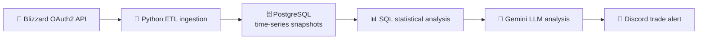

<h1 align="center">🪙 WoW Market Arbitrage Agent 🪙</h1>

<p align="center">
  
</p>

<p align="center">
  
  
  
  
  
</p>

<p align="center">
  <a href="#overview">Overview</a> •
  <a href="#capabilities">Capabilities</a> •
  <a href="#how-it-works">How It Works</a> •
  <a href="#setup">Setup</a>
</p>

---

## Overview

An automated data pipeline, relational data model, and arbitrage detection system for the World of Warcraft Auction House. It processes over 280,000 active commodity listings through Blizzard's official API, stores historical snapshots in PostgreSQL, calculates price deviations, and uses Google Gemini to turn the results into actionable trade alerts on Discord.

## Capabilities

- OAuth2 authentication with Blizzard's official API
- Processing and filtering of large auction volumes (280,000+ active listings)
- Automatic currency normalization from copper to gold
- Relational modeling with time-series snapshots in PostgreSQL
- Price deviation and weighted average analysis with SQL
- LLM analysis of market risk, liquidity, and expansion context
- Automated buy and sell alerts delivered through Discord webhooks

**Data model:** `items` and `auction_snapshots` tables linked by foreign keys, with SQL aggregations (`AVG`, `MIN`, `ROUND`, `GROUP BY`, `JOIN`) for price anomaly detection.

## How It Works



### Business Logic

| Pillar | How it works |
|---|---|
| **Quantitative deviation** | Compares the lowest active listing with the weighted average price stored in the database |
| **Qualitative AI review** | Evaluates market liquidity, patch and expansion risk, and net margin after the 5% Auction House fee |

## Tech Stack

| Layer | Technology |
|---|---|
| **Language** | Python 3.10+ with `psycopg2-binary`, `requests`, `google-genai`, `python-dotenv` |
| **Database** | PostgreSQL 15 in Docker, administered with DBeaver |
| **Data source** | Blizzard Battle.net OAuth2 REST API |
| **AI** | Google Gemini API (`gemini-2.5-flash`) |
| **Alerts** | Discord webhooks |

## Design Decision

Decisions are not blindly delegated to AI. The system's foundation is mathematical and grounded in relational SQL data. The LLM acts strictly as the contextual intelligence layer, supporting exit strategy formulation.

## Security

- Sensitive credentials and API keys are isolated in `.env`
- `.gitignore` keeps secrets out of version control
- Environment variables are documented in `.env.example`
- The database runs in a container with parameterized credentials

## Setup

1. Clone the repository and enter the folder:

   ```bash
   git clone https://github.com/igorhsouza/wow-market-arbitrage-agent.git
   cd wow-market-arbitrage-agent
   ```

2. Start the database:

   ```bash
   docker compose up -d
   ```

3. Configure environment variables:

   ```bash
   cp .env.example .env
   ```

   Fill in your Blizzard, Google AI Studio, and Discord webhook credentials in `.env`.

4. Install dependencies:

   ```bash
   pip install -r requirements.txt
   ```

5. Run the ingestion, then the analysis:

   ```bash
   python fetch_market.py
   python market_analyst.py
   ```

## Example Output

<p align="center">
  
</p>

<details>
<summary><b>Show English translation</b></summary>

**🔔 NEW AUCTION HOUSE MARKET ANALYSIS 🔔**

**📈 GOBLIN ARBITRAGE RADAR 🌿**

Easy there, legend! Before you start celebrating, thinking you'll buy a Brutosaur with a handful of flowers, let's face reality:

1. **Verdict: BUY 🛒** (but without Gallywix-level greed!)
2. **Risk & Margin:**
   - **Risk:** 🟢 **Almost none.** Buying these 1,675 units at 3.50g will cost you a measly ~5,800g, the pocket change you'd find on the ground in Dornogal.
   - **Margin:** 🟡 **Moderate/Good.** Forget the 30.98g average, that's a mirage in the Silithus desert! Hochenblume spawns even in sewer grates. But doubling your investment by selling at 7g–9g to a desperate alchemist on raid reset day is pure profit (100%+ real ROI).
3. **Recommended Action:**
   - **Buy out this mess now.** 5.8k gold won't even break a *free trial* account.
   - **DON'T list at 30g.** Nobody will buy it, and your gold will bleed in the AH deposit.
   - **Exit strategy:** Spread the flowers across smaller stacks priced between **7.50g and 11.00g** on Tuesday/Wednesday (reset day). If you're an Alchemist or Herbalist, process them into pigment or potions and the return is even faster! 💰✨

</details>

## Author

**Igor Henrique** · Automation • Data • Systems
